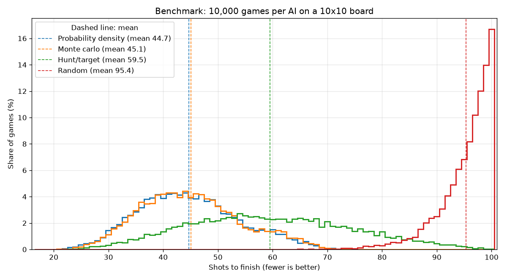

 battleship-rl

Play Battleship against five AI opponents, from a random shooter to a reinforcement learning agent I trained myself, and see exactly how good each one is.

> **Status:** in development. Live demo and results arrive with the milestones below.

## The question

How does a reinforcement learning agent compare to heuristic strategies in Battleship, and how can such an agent be developed, evaluated and deployed in a reproducible and testable way?

## The opponents

| Opponent | Strategy | Mean | Median | Std |
| --- | --- | --- | --- | --- |
| Random | Fires at any unfired square | 95.4 | 97 | 4.8 |
| Hunt/target | Random until a hit, then fires at neighbours | 59.5 | 59 | 14.8 |
| Probability density | Fires where the remaining ships fit in the most ways | 44.7 | 44 | 9.2 |
| Monte Carlo | Samples possible layouts of the remaining ships, fires where a ship lies most often | 45.1 | 44 | 9.2 |
| RL agent | MaskablePPO, trained with Stable-Baselines3 | measured in M4 | | |

Shots to finish a 10x10 board with ships of length 5, 4, 3, 3 and 2. Every opponent plays the same 10,000 seeded random boards, so fewer shots is better and the numbers compare board for board. The 95% confidence interval of every mean is narrower than ±0.3 shots.



Reproduce it (about five minutes on 12 cores; full results in `results/benchmark.json`):

```bash
uv run python -m battleship.benchmark
uv run python -m battleship.benchmark --config small
```

## How it works

One Python game engine (`src/battleship`) is the single source of truth. The FastAPI server, every AI and the training environment all use it, so the rules can never drift apart. The server keeps each game's state, so the browser never knows where the AI's ships are.

| Part | Tech |
| --- | --- |
| Game engine | Python 3.12 |
| Backend | FastAPI |
| Frontend | Plain HTML, CSS, JavaScript |
| Training | Gymnasium, Stable-Baselines3, sb3-contrib |
| Hosting | Hugging Face Spaces (Docker) |
| Model | Hugging Face Hub |
| Quality | pytest, ruff, GitHub Actions |

## Run it locally

```bash
uv sync
uv run uvicorn app.main:app --reload
# open http://localhost:8000
```

Run the checks:

```bash
uv run ruff check .
uv run pytest
```

Training dependencies are optional: `uv sync --extra rl`.

## Roadmap

- [ ] **v0.1** Game engine with tests
- [ ] **v0.2** Heuristic AIs and benchmark
- [ ] **v0.3** Playable online
- [ ] **v0.4** Trained agent in the game
- [ ] **v1.0** Results, write-up and advice

## Documentation

- [Plan](docs/plan.md): research question, scope and schedule
- [Research notes](docs/research.md)
- [Experiment log](docs/experiments.md)
- [Advice](docs/advice.md): the answer to the research question

## License

[MIT](LICENSE)
